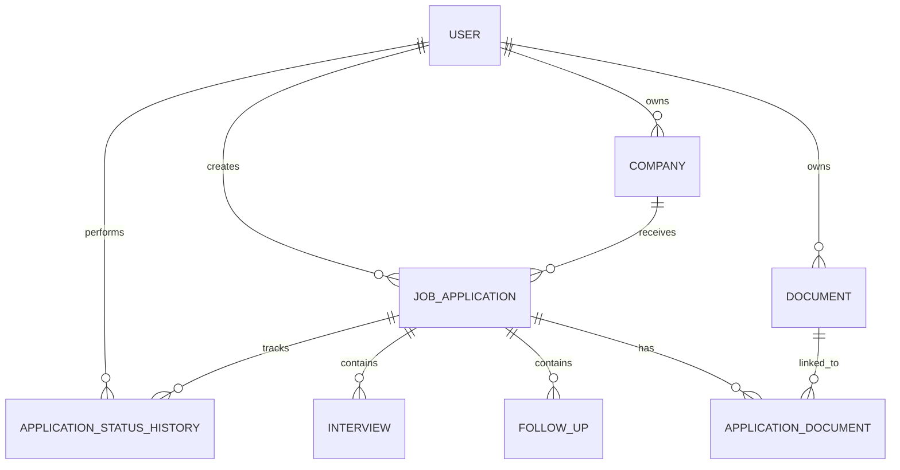
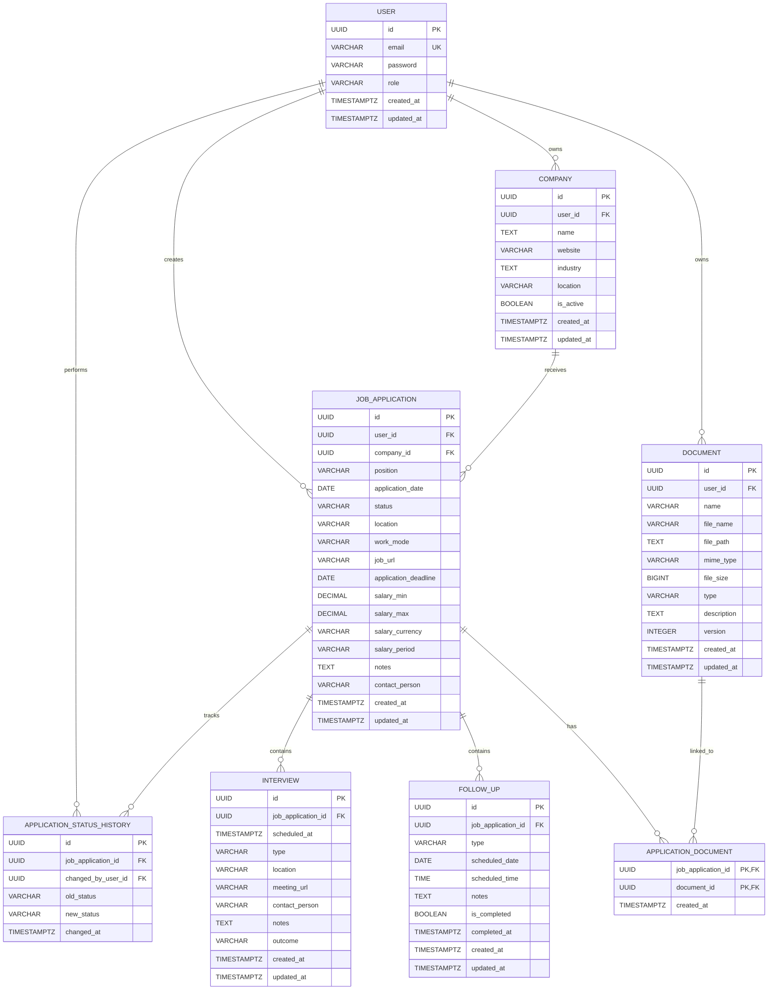

## 1. User Entity

The User entity represents an authenticated account within the application.

### 1.1 Fields

|Field|Database Type|Constraints|Description|
|---|---|---|---|
|`id`|UUID|PRIMARY KEY|Unique user identifier, generated by Java|
|`email`|VARCHAR(255)|NOT NULL, UNIQUE INDEX ON LOWER(email)|User login identifier|
|`password`|VARCHAR(255)|NOT NULL|BCrypt password hash|
|`role`|VARCHAR|NOT NULL, CHECK|User authorization role|
|`created_at`|TIMESTAMPTZ|NOT NULL|Account creation timestamp|
|`updated_at`|TIMESTAMPTZ|NOT NULL|Last account update timestamp|

### 1.2 Business Rules

- Email addresses are normalized using `trim()` and lowercase before storage and authentication.
    
- Email uniqueness is enforced case-insensitively at database level using a unique index on `LOWER(email)`.
    
- Passwords are never stored in plaintext. BCrypt hashing is used.
    
- Role values are represented by a Java Enum and stored as strings.
    
- Role assignment is handled by the application, never directly by the user during registration.
    
- Public registration assigns the standard USER role. ADMIN privileges are assigned through controlled application-side administration.
    
- User IDs are generated by the Java application using UUID.

### 1.3 Timestamp Management

- `created_at` is assigned when the User is created and remains unchanged.
    
- `updated_at` is assigned during creation and updated whenever the User is modified.
    
- Hibernate manages both timestamps using `@CreationTimestamp` and `@UpdateTimestamp`.

### 1.4 Relationships

- One User can have multiple Job Applications.
    
- Each Job Application belongs to exactly one User.
    
- One User can have multiple Companies.
    
- Each Company belongs to exactly one User.
    
- Deleting a User cascades to their Job Applications and dependent records.
    
- User-owned Company records are also associated with the User and follow the defined deletion restrictions.
    
- Document records and physical files are not automatically deleted when a User is deleted. They require explicit deletion.

### 1.5 Database Integrity

- `id` is the Primary Key.
    
- `email` must be unique, non-null and non-blank.
    
- Email uniqueness is enforced case-insensitively through a unique index on `LOWER(email)`.
    
- `password` must not be null.
    
- `role` must contain an allowed value, enforced through a CHECK constraint.
    
- `created_at` and `updated_at` must not be null.
    
- A CHECK constraint ensures that `email` does not contain only whitespace.

---

## 2. Company Entity

The Company entity represents an organization that belongs to a specific User and to which one or more Job Applications can be submitted.

### 2.1 Fields

|Field|Database Type|Constraints|Description|
|---|---|---|---|
|`id`|UUID|PRIMARY KEY|Unique company identifier, generated by Java|
|`user_id`|UUID|NOT NULL, FOREIGN KEY|Owner of the company|
|`name`|TEXT|NOT NULL, CHECK, UNIQUE INDEX|Canonical company name|
|`website`|VARCHAR(255)|NULL allowed|Official company website|
|`industry`|TEXT|NULL allowed|Industry or business sector|
|`location`|VARCHAR(255)|NULL allowed|Company's location or headquarters|
|`is_active`|BOOLEAN|NOT NULL, DEFAULT TRUE|Company availability for new applications|
|`created_at`|TIMESTAMPTZ|NOT NULL|Creation timestamp|
|`updated_at`|TIMESTAMPTZ|NOT NULL|Last update timestamp|

### 2.2 Business Rules

- Companies belong to individual Users. They are not shared across different users.
    
- A User can create and manage Companies independently of Job Applications.
    
- Company names are trimmed before storage.
    
- Original capitalization is preserved for display.
    
- Duplicate detection is case-insensitive and scoped to the owning User.
    
- A composite unique database index on `(user_id, LOWER(name))` prevents duplicate company names within the same user's company catalog.
    
- Different Users can have Companies with the same name.
    
- Website stores the complete URL, including protocol.
    
- Website values are validated by the application.
    
- Industry is free-text to support companies operating across multiple sectors.
    
- Company location represents the company's location or headquarters, not the location or work mode of an individual job position.
    
- New Companies are active by default.
    
- The application assigns `is_active = true` when creating a new Company.

### 2.3 Company Lifecycle

- Active Companies are available when creating new Job Applications.
    
- Inactive Companies are excluded from new application selections.
    
- Inactive Companies remain associated with existing Job Applications for historical purposes.
    
- The application validates company activity before creating a new Job Application.
    
- Permanent deletion is allowed only when no Job Applications reference the Company.
    
- Company deletion is restricted at database level when referenced by Job Applications.
    
- Deactivating a Company does not delete its existing Job Applications.

### 2.4 Relationships

- One User can have multiple Companies.
    
- Each Company belongs to exactly one User.
    
- The `user_id` Foreign Key is stored in Company and references User.
    
- One Company can have multiple Job Applications.
    
- Each Job Application must belong to exactly one Company.
    
- The `company_id` Foreign Key is stored in JobApplication and references Company.
    
- The Company-to-JobApplication Foreign Key uses `ON DELETE RESTRICT`.
    
- The application Service validates that the Company and JobApplication belong to the same User.

### 2.5 Timestamp Management

- `created_at` is assigned during creation and remains unchanged.
    
- `updated_at` is updated whenever the Company is modified.
    
- Hibernate manages timestamps using `@CreationTimestamp` and `@UpdateTimestamp`.

### 2.6 Database Integrity

- `id` is the Primary Key.
    
- `user_id` must not be null and must reference an existing User.
    
- `name` must not be null or blank.
    
- Company name uniqueness is enforced per User through a unique index on `(user_id, LOWER(name))`.
    
- `is_active` must not be null and defaults to TRUE.
    
- `created_at` and `updated_at` must not be null.
    
- The `company_id` Foreign Key in JobApplication prevents deletion of a Company that is still referenced by existing applications.


## 3. JobApplication Entity

The JobApplication entity represents a job opportunity tracked by a User. It contains information about the position, the associated Company, the application status and relevant employment details.

### 3.1 Fields

|Field|Database Type|Constraints|Description|
|---|---|---|---|
|`id`|UUID|PRIMARY KEY|Unique application identifier, generated by Java|
|`user_id`|UUID|NOT NULL, FOREIGN KEY|Owner of the application|
|`company_id`|UUID|NOT NULL, FOREIGN KEY|Company associated with the application|
|`position`|VARCHAR(255)|NOT NULL|Job title or position|
|`application_date`|DATE|NULL allowed, conditionally required|Date the application was submitted|
|`status`|VARCHAR|NOT NULL, CHECK|Current application status|
|`location`|VARCHAR(255)|NULL allowed|Location of the specific job position|
|`work_mode`|VARCHAR|NULL allowed, CHECK|Work arrangement|
|`job_url`|VARCHAR(2048)|NULL allowed|URL of the job advertisement|
|`application_deadline`|DATE|NULL allowed|Application deadline|
|`salary_min`|DECIMAL|NULL allowed|Minimum salary amount|
|`salary_max`|DECIMAL|NULL allowed|Maximum salary amount|
|`salary_currency`|VARCHAR(3)|NULL allowed|Salary currency (ISO 4217)|
|`salary_period`|VARCHAR|NULL allowed, CHECK|Salary period|
|`notes`|TEXT|NULL allowed|Additional notes about the application|
|`contact_person`|VARCHAR(255)|NULL allowed|Contact person or recruiter|
|`created_at`|TIMESTAMPTZ|NOT NULL|Record creation timestamp|
|`updated_at`|TIMESTAMPTZ|NOT NULL|Last record update timestamp|

### 3.2 Application Status

The application status is represented by a Java Enum and stored as a string.

Allowed values:

- `WISHLIST`
    
- `APPLIED`
    
- `SCREENING`
    
- `INTERVIEW`
    
- `OFFER`
    
- `REJECTED`
    
- `WITHDRAWN`

The database enforces the allowed values through a CHECK constraint.

### 3.3 Work Mode

The work mode is represented by a Java Enum and stored as a string.

Allowed values:

- `REMOTE`
    
- `ON_SITE`
    
- `HYBRID`

Work mode is optional because the job advertisement may not specify the arrangement.

### 3.4 Salary Information

Salary information consists of four optional fields:

- `salary_min`
    
- `salary_max`
    
- `salary_currency`
    
- `salary_period`

Allowed salary periods:

- `YEARLY`
    
- `MONTHLY`
    
- `HOURLY`

Business rules:

- Salary amounts must be greater than zero.
    
- If either salary amount is provided, both currency and period are required.
    
- If both minimum and maximum amounts are provided, the minimum must not exceed the maximum.
    
- If no salary information is provided, all four fields remain NULL.
    
- A fixed salary can be represented by setting the minimum and maximum amounts to the same value.
    
- Currency uses the ISO 4217 standard, for example EUR.

### 3.5 Business Rules

- Every JobApplication belongs to exactly one User.
    
- Every JobApplication must reference exactly one Company.
    
- The Company must belong to the same User as the JobApplication.
    
- The application obtains the User identity from the authenticated session. The client must never be trusted to provide or override the owner ID.
    
- A User can create Companies independently of JobApplications.
    
- `application_date` represents the actual date the application was submitted, not the date the record was created.
    
- `created_at` and `updated_at` represent record lifecycle timestamps and are independent of `application_date`.
    
- `application_deadline` represents the deadline specified by the job advertisement.
    
- A JobApplication with status `WISHLIST` does not require an application date.
    
- Every other status requires a non-null application date.
    
- Transitioning from `WISHLIST` to `APPLIED` requires setting the application date.
    
- Inactive Companies cannot be selected for new JobApplications.
    
- Existing JobApplications remain associated with their Company if that Company becomes inactive.

### 3.6 Duplicate Application Prevention

The application prevents duplicate active applications for the same:

- User
    
- Company
    
- Position

The following statuses are considered active:

- `APPLIED`
    
- `SCREENING`
    
- `INTERVIEW`
    
- `OFFER`

The following statuses do not prevent a new application:

- `WISHLIST`
    
- `REJECTED`
    
- `WITHDRAWN`

Business rules:

- A User cannot have more than one active application for the same Company and Position.
    
- A new application is allowed after a previous application becomes `REJECTED` or `WITHDRAWN`.
    
- A `WISHLIST` entry does not prevent the creation of another application.
    
- The Service performs a preliminary duplicate check.
    
- A PostgreSQL partial unique index enforces the rule at database level and protects against concurrent insertions.

### 3.7 Timestamp Management

- `created_at` is assigned during creation and remains unchanged.
    
- `updated_at` is updated whenever the JobApplication is modified.
    
- Hibernate manages timestamps using `@CreationTimestamp` and `@UpdateTimestamp`.

### 3.8 Relationships

- One User can have multiple JobApplications.
    
- Each JobApplication belongs to exactly one User.
    
- One Company can have multiple JobApplications.
    
- Each JobApplication belongs to exactly one Company.
    
- One JobApplication can have multiple ApplicationStatusHistory records.
    
- One JobApplication can have multiple Interviews.
    
- One JobApplication can have multiple FollowUps.
    
- One JobApplication can be associated with multiple Documents through ApplicationDocument.
    
- Deleting a JobApplication cascades to its ApplicationStatusHistory, Interviews, FollowUps and ApplicationDocument associations.
    
- Deleting a JobApplication does not delete the associated Document records or physical files.

### 3.9 Database Integrity

- `id` is the Primary Key.
    
- `user_id` must not be null and must reference an existing User.
    
- `company_id` must not be null and must reference an existing Company.
    
- `position` must not be null or blank.
    
- `status` must contain an allowed value.
    
- `work_mode`, when provided, must contain an allowed value.
    
- `salary_period`, when provided, must contain an allowed value.
    
- `application_date` must not be null when status is different from `WISHLIST`.
    
- Salary amounts must be greater than zero.
    
- If either salary amount is provided, `salary_currency` and `salary_period` must also be provided.
    
- If both salary amounts are provided, `salary_min` must be less than or equal to `salary_max`.
    
- A partial unique index prevents duplicate active applications for the same User, Company and Position.
    
- `created_at` and `updated_at` must not be null.

### 3.10 Indexes

The following indexes are planned to support common application queries:

- Index on `user_id` for retrieving applications belonging to a User.
    
- Index on `company_id` for retrieving applications associated with a Company.
    
- Index on `status` for filtering applications by status.
    
- Index on `application_date` for date-based filtering and sorting.
    
- Partial unique index on `(user_id, company_id, position)` for active application duplicate prevention.

Additional indexes may be introduced later based on actual query patterns and performance requirements.


## 4. ApplicationStatusHistory Entity

The ApplicationStatusHistory entity records the status changes of a JobApplication over time. It provides an audit trail of the application's status lifecycle.

### 4.1 Fields

|Field|Database Type|Constraints|Description|
|---|---|---|---|
|`id`|UUID|PRIMARY KEY|Unique history record identifier, generated by Java|
|`job_application_id`|UUID|NOT NULL, FOREIGN KEY|Associated JobApplication|
|`old_status`|VARCHAR|NULL allowed, CHECK|Previous application status|
|`new_status`|VARCHAR|NOT NULL, CHECK|New application status|
|`changed_at`|TIMESTAMPTZ|NOT NULL|Date and time of the status change|
|`changed_by_user_id`|UUID|NOT NULL, FOREIGN KEY|User who performed the change|

### 4.2 Business Rules

- Every JobApplication must have an initial status history record created when the application is first created.
    
- For the initial history record, `old_status` is NULL and `new_status` contains the application's initial status.
    
- Every subsequent status change creates a new ApplicationStatusHistory record.
    
- Changes to other JobApplication fields do not create status history records.
    
- Status history records are immutable after creation.
    
- `changed_at` records the exact date and time when the status change occurred.
    
- `changed_by_user_id` identifies the authenticated User who performed the change.
    
- The application obtains the acting User from the authenticated session. The client must never be trusted to provide or override this value.
    
- The status history record and the corresponding JobApplication status update must be persisted within the same database transaction.
    
- The Service validates that the User performing the change owns the associated JobApplication.

### 4.3 Timestamp Management

- `changed_at` is assigned when the history record is created.
    
- The timestamp is immutable and is never updated.
    
- The application or Hibernate manages the timestamp during persistence.

### 4.4 Relationships

- One JobApplication can have multiple ApplicationStatusHistory records.
    
- Each ApplicationStatusHistory record belongs to exactly one JobApplication.
    
- One User can perform multiple status changes.
    
- Each ApplicationStatusHistory record references exactly one User through `changed_by_user_id`.
    
- Deleting a JobApplication cascades to its ApplicationStatusHistory records.
    
- Deleting a User is subject to the defined ownership and deletion policies.

### 4.5 Database Integrity

- `id` is the Primary Key.
    
- `job_application_id` must not be null and must reference an existing JobApplication.
    
- `changed_by_user_id` must not be null and must reference an existing User.
    
- `old_status` may be NULL only for the initial status history record.
    
- `new_status` must not be null.
    
- Both `old_status` and `new_status`, when provided, must contain an allowed JobApplication status value.
    
- `changed_at` must not be null.
    
- The Foreign Key referencing JobApplication uses `ON DELETE CASCADE`.
    
- Status history records are not automatically deleted when a JobApplication's status changes; each change creates a separate record.
    
- The Foreign Key referencing User through `changed_by_user_id` uses `ON DELETE CASCADE`.

### 4.6 Indexes

- Index on `job_application_id` for retrieving the status history of a JobApplication.
    
- Index on `changed_by_user_id` for retrieving status changes performed by a User.


## 5. Interview Entity

The Interview entity represents an interview or assessment associated with a specific JobApplication. A JobApplication can have multiple Interviews throughout its recruitment process.

### 5.1 Fields

|Field|Database Type|Constraints|Description|
|---|---|---|---|
|`id`|UUID|PRIMARY KEY|Unique interview identifier, generated by Java|
|`job_application_id`|UUID|NOT NULL, FOREIGN KEY|Associated JobApplication|
|`scheduled_at`|TIMESTAMPTZ|NOT NULL|Scheduled interview date and time|
|`type`|VARCHAR|NOT NULL, CHECK|Interview or assessment type|
|`location`|VARCHAR(255)|NULL allowed|Physical interview location|
|`meeting_url`|VARCHAR(2048)|NULL allowed|Online meeting URL|
|`contact_person`|VARCHAR(255)|NULL allowed|Interviewer or recruiter|
|`notes`|TEXT|NULL allowed|Additional interview notes|
|`outcome`|VARCHAR|NOT NULL, CHECK, DEFAULT 'PENDING'|Current interview outcome|
|`created_at`|TIMESTAMPTZ|NOT NULL|Record creation timestamp|
|`updated_at`|TIMESTAMPTZ|NOT NULL|Last record update timestamp|

### 5.2 Interview Type

The interview type is represented by a Java Enum and stored as a string.

Allowed values:

- `HR`
    
- `TECHNICAL`
    
- `CODING_ASSESSMENT`
    
- `BEHAVIORAL`
    
- `FINAL`
    
- `OTHER`

The database enforces the allowed values through a CHECK constraint.

### 5.3 Interview Outcome

The interview outcome is represented by a Java Enum and stored as a string.

Allowed values:

- `PENDING`
    
- `PASSED`
    
- `FAILED`
    
- `RESCHEDULED`
    
- `CANCELLED`

Business rules:

- Every new Interview starts with the `PENDING` outcome.
    
- The outcome can be updated as the recruitment process progresses.
    
- `RESCHEDULED` indicates that the interview has been rescheduled.
    
- When an interview is rescheduled, its `scheduled_at` value is updated to the new date and time.
    
- Only the current outcome is stored. Previous outcomes are not maintained in a separate history entity.

### 5.4 Business Rules

- Every Interview belongs to exactly one JobApplication.
    
- A JobApplication can have multiple Interviews.
    
- Each Interview must have a scheduled date and time.
    
- `scheduled_at` uses TIMESTAMPTZ to preserve the correct point in time across different time zones.
    
- `location` and `meeting_url` are optional because interviews can take place either in person or online.
    
- `contact_person` is specific to each Interview because different interview stages may involve different interviewers.
    
- `notes` stores additional information relevant to the specific interview.
    
- The application validates that the authenticated User owns the associated JobApplication.
    
- The client must never be trusted to provide or override the JobApplication owner ID.

### 5.5 Timestamp Management

- `created_at` is assigned when the Interview is created and remains unchanged.
    
- `updated_at` is updated whenever the Interview is modified.
    
- Hibernate manages timestamps using `@CreationTimestamp` and `@UpdateTimestamp`.

### 5.6 Relationships

- One JobApplication can have multiple Interviews.
    
- Each Interview belongs to exactly one JobApplication.
    
- The `job_application_id` Foreign Key is stored in Interview and references JobApplication.
    
- Deleting a JobApplication cascades to its associated Interviews.
    
- Deleting an Interview does not affect its associated JobApplication.

### 5.7 Database Integrity

- `id` is the Primary Key.
    
- `job_application_id` must not be null and must reference an existing JobApplication.
    
- `scheduled_at` must not be null.
    
- `type` must contain an allowed Interview type.
    
- `outcome` must contain an allowed Interview outcome.
    
- `outcome` defaults to `PENDING`.
    
- `created_at` and `updated_at` must not be null.
    
- The Foreign Key referencing JobApplication uses `ON DELETE CASCADE`.

### 5.8 Indexes

- Index on `job_application_id` for retrieving Interviews associated with a JobApplication.


## 6. FollowUp Entity

The FollowUp entity represents a planned or completed follow-up action associated with a specific JobApplication. It helps Users keep track of communications and reminders throughout the recruitment process.

### 6.1 Fields

|Field|Database Type|Constraints|Description|
|---|---|---|---|
|`id`|UUID|PRIMARY KEY|Unique follow-up identifier, generated by Java|
|`job_application_id`|UUID|NOT NULL, FOREIGN KEY|Associated JobApplication|
|`type`|VARCHAR|NOT NULL, CHECK|Follow-up action type|
|`scheduled_date`|DATE|NOT NULL|Planned follow-up date|
|`scheduled_time`|TIME|NULL allowed|Planned follow-up time|
|`notes`|TEXT|NULL allowed|Additional follow-up details|
|`is_completed`|BOOLEAN|NOT NULL, DEFAULT FALSE|Indicates whether the follow-up has been completed|
|`completed_at`|TIMESTAMPTZ|NULL allowed|Date and time when the follow-up was completed|
|`created_at`|TIMESTAMPTZ|NOT NULL|Record creation timestamp|
|`updated_at`|TIMESTAMPTZ|NOT NULL|Last record update timestamp|

### 6.2 FollowUp Type

The follow-up type is represented by a Java Enum and stored as a string.

Allowed values:

- `APPLICATION_STATUS_INQUIRY`
    
- `INTERVIEW_FEEDBACK_REQUEST`
    
- `REJECTION_FEEDBACK_REQUEST`
    
- `THANK_YOU_MESSAGE`
    
- `OTHER`

The database enforces the allowed values through a CHECK constraint.

### 6.3 Business Rules

- Every FollowUp belongs to exactly one JobApplication.
    
- A JobApplication can have multiple FollowUps.
    
- Every FollowUp must have a scheduled date.
    
- The scheduled time is optional because a User may plan a follow-up for a particular day without specifying an exact time.
    
- FollowUps can be associated with JobApplications regardless of their current status, including `REJECTED` and `WITHDRAWN`.
    
- A FollowUp starts with `is_completed = FALSE`.
    
- When a FollowUp is marked as completed, `completed_at` is assigned the exact completion date and time.
    
- When a completed FollowUp is reopened, `is_completed` becomes FALSE and `completed_at` is cleared.
    
- The application manages the completion timestamp. The client must not directly provide or override it.
    
- `notes` stores additional information about the planned communication or action.
    
- The application validates that the authenticated User owns the associated JobApplication.

### 6.4 Completion Management

The following rules maintain consistency between `is_completed` and `completed_at`:

|`is_completed`|`completed_at`|Meaning|
|---|---|---|
|FALSE|NULL|Pending follow-up|
|TRUE|NOT NULL|Completed follow-up|

The database enforces this relationship through a CHECK constraint:

- If `is_completed` is FALSE, `completed_at` must be NULL.
    
- If `is_completed` is TRUE, `completed_at` must not be NULL.

### 6.5 Timestamp Management

- `created_at` is assigned when the FollowUp is created and remains unchanged.
    
- `updated_at` is updated whenever the FollowUp is modified.
    
- Hibernate manages timestamps using `@CreationTimestamp` and `@UpdateTimestamp`.
    
- `completed_at` is assigned when the FollowUp is completed and cleared if it is reopened.

### 6.6 Relationships

- One JobApplication can have multiple FollowUps.
    
- Each FollowUp belongs to exactly one JobApplication.
    
- The `job_application_id` Foreign Key is stored in FollowUp and references JobApplication.
    
- Deleting a JobApplication cascades to its associated FollowUps.
    
- Deleting a FollowUp does not affect its associated JobApplication.

### 6.7 Database Integrity

- `id` is the Primary Key.
    
- `job_application_id` must not be null and must reference an existing JobApplication.
    
- `type` must contain an allowed FollowUp type.
    
- `scheduled_date` must not be null.
    
- `is_completed` must not be null and defaults to FALSE.
    
- `completed_at` must be NULL when `is_completed` is FALSE and NOT NULL when `is_completed` is TRUE.
    
- `created_at` and `updated_at` must not be null.
    
- The Foreign Key referencing JobApplication uses `ON DELETE CASCADE`.

### 6.8 Indexes

- Index on `job_application_id` for retrieving FollowUps associated with a JobApplication.


## 7. Document Entity

The Document entity represents a file uploaded and managed by a User. It stores the file's metadata in the database, while the actual physical file is stored in the filesystem.

Documents are independent of JobApplications and can be associated with multiple applications through the ApplicationDocument association entity.

### 7.1 Fields

|Field|Database Type|Constraints|Description|
|---|---|---|---|
|`id`|UUID|PRIMARY KEY|Unique document identifier, generated by Java|
|`user_id`|UUID|NOT NULL, FOREIGN KEY|Owner of the document|
|`name`|VARCHAR(255)|NOT NULL|User-defined logical document name|
|`file_name`|VARCHAR(255)|NOT NULL|Original uploaded filename|
|`file_path`|TEXT|NOT NULL|Relative storage path of the physical file|
|`mime_type`|VARCHAR(100)|NOT NULL|File MIME type|
|`file_size`|BIGINT|NOT NULL|File size in bytes|
|`type`|VARCHAR|NOT NULL, CHECK|Document category|
|`description`|TEXT|NULL allowed|Additional document information|
|`version`|INTEGER|NOT NULL, DEFAULT 1|Version number within a logical document series|
|`created_at`|TIMESTAMPTZ|NOT NULL|Upload timestamp|
|`updated_at`|TIMESTAMPTZ|NOT NULL|Last metadata update timestamp|

### 7.2 Document Type

The document type is represented by a Java Enum and stored as a string.

Allowed values:

- `CV`
    
- `COVER_LETTER`
    
- `CERTIFICATE`
    
- `OTHER`

The database enforces the allowed values through a CHECK constraint.

### 7.3 Business Rules

- Every Document belongs to exactly one User.
    
- Documents are stored independently of JobApplications.
    
- The database stores document metadata, while the actual file is stored in the filesystem.
    
- `name` is a user-defined logical name used to identify and group related document versions.
    
- `file_name` preserves the original uploaded filename.
    
- Multiple Documents may have the same `file_name`.
    
- `file_path` stores a relative path rather than an absolute filesystem path.
    
- The storage location is configurable through application configuration.
    
- The application initially enforces a maximum upload size of 10 MB.
    
- The maximum upload size is configurable through application configuration.
    
- The backend validates the actual file content and does not blindly trust the filename or client-provided MIME type.
    
- The file extension can be derived from `file_name` and is not stored separately.
    
- A new upload does not overwrite an existing Document.
    
- Documents remain stored even when they are no longer associated with any JobApplication.
    
- Documents and physical files are deleted only through an explicit User deletion action.

### 7.4 Document Versioning

Documents support versioning based on their logical `name`.

Business rules:

- Each new Document with the same logical name receives the next version number.
    
- Version numbering starts at 1.
    
- Version numbering is scoped to the owning User and logical document name.
    
- Each version is stored as a separate Document record with its own UUID and physical file.
    
- Version numbers do not indicate that a document is necessarily better or newer in terms of content quality.
    
- Different versions may represent different CV variations targeting different industries, positions or companies.
    
- The User decides which version to associate with each JobApplication.
    
- Uploading a new version does not automatically replace existing ApplicationDocument associations.
    
- Version assignment must be safe against concurrent uploads.

Example:

|Document Name|Version|Purpose|
|---|---|---|
|Java Backend CV|1|General Java Backend applications|
|Java Backend CV|2|Updated Java Backend CV|
|Fintech CV|1|Fintech-focused applications|

### 7.5 File Storage

- Physical files are stored in the filesystem.
    
- The database stores the file's metadata and relative storage path.
    
- The storage directory is configurable.
    
- Docker deployments use a persistent Docker Volume for file storage.
    
- Recreating the application container must not remove uploaded files.
    
- Local development and homelab deployments can use different storage locations.
    
- Public demo environments must use isolated sample files and storage rather than personal documents.

### 7.6 File Deletion

- Deleting a JobApplication does not delete its associated Documents.
    
- Removing a Document association does not delete the Document or its physical file.
    
- A Document can be permanently deleted only through an explicit User action.
    
- Explicit Document deletion removes its ApplicationDocument associations, database record and physical file.
    
- File deletion and database deletion are not part of a single atomic transaction.
    
- The application must handle filesystem deletion failures carefully to avoid inconsistent database and file states.

### 7.7 Timestamp Management

- `created_at` is assigned when the Document is uploaded and remains unchanged.
    
- `updated_at` is updated whenever the Document metadata is modified.
    
- Hibernate manages timestamps using `@CreationTimestamp` and `@UpdateTimestamp`.

### 7.8 Relationships

- One User can have multiple Documents.
    
- Each Document belongs to exactly one User.
    
- One Document can be associated with multiple JobApplications through ApplicationDocument.
    
- One JobApplication can be associated with multiple Documents through ApplicationDocument.
    
- Deleting a JobApplication removes its ApplicationDocument associations but does not delete the associated Documents.
    
- Deleting a Document removes its associated ApplicationDocument records.
    
- Document ownership is validated by the application Service before associating it with a JobApplication.

### 7.9 Database Integrity

- `id` is the Primary Key.
    
- `user_id` must not be null and must reference an existing User.
    
- `name`, `file_name`, `file_path` and `mime_type` must not be null.
    
- `file_size` must not be null and must be greater than zero.
    
- `type` must contain an allowed Document type.
    
- `version` must not be null and must be greater than zero.
    
- `created_at` and `updated_at` must not be null.
    
- The database must enforce version uniqueness within the same User and logical document name.

### 7.10 Indexes

- Index on `user_id` for retrieving Documents belonging to a User.
    
- Unique index on `(user_id, name, version)` for preventing duplicate version numbers within a logical document series.


## 8. ApplicationDocument Entity

The ApplicationDocument entity represents the association between a JobApplication and a Document. It implements the many-to-many relationship between these two entities.

It allows a Document to be reused across multiple JobApplications and each JobApplication to have multiple associated Documents.

### 8.1 Fields

|Field|Database Type|Constraints|Description|
|---|---|---|---|
|`job_application_id`|UUID|PRIMARY KEY (COMPOSITE), FOREIGN KEY|Associated JobApplication|
|`document_id`|UUID|PRIMARY KEY (COMPOSITE), FOREIGN KEY|Associated Document|
|`created_at`|TIMESTAMPTZ|NOT NULL|Date and time when the association was created|

### 8.2 Business Rules

- Each ApplicationDocument record connects exactly one JobApplication with exactly one Document.
    
- A JobApplication can have multiple associated Documents.
    
- A Document can be associated with multiple JobApplications.
    
- The same Document cannot be associated with the same JobApplication more than once.
    
- Users can choose which Document version to associate with each JobApplication.
    
- Associating a new Document version does not automatically replace existing associations.
    
- The application Service validates that the Document and JobApplication belong to the same User.
    
- Users cannot associate Documents owned by other Users with their JobApplications.

### 8.3 Relationships

- One JobApplication can have multiple ApplicationDocument records.
    
- Each ApplicationDocument record belongs to exactly one JobApplication.
    
- One Document can have multiple ApplicationDocument records.
    
- Each ApplicationDocument record references exactly one Document.
    
- The `job_application_id` Foreign Key references JobApplication.
    
- The `document_id` Foreign Key references Document.

### 8.4 Deletion Rules

- Deleting a JobApplication cascades to its associated ApplicationDocument records.
    
- Deleting a Document cascades to its associated ApplicationDocument records.
    
- Deleting an ApplicationDocument record does not delete the associated JobApplication or Document.
    
- Removing an association does not delete the physical file.
    
- Physical files are deleted only when the corresponding Document is explicitly deleted by its owner.

### 8.5 Database Integrity

- The composite Primary Key consists of `(job_application_id, document_id)`.
    
- `job_application_id` must not be null and must reference an existing JobApplication.
    
- `document_id` must not be null and must reference an existing Document.
    
- `created_at` must not be null.
    
- Both Foreign Keys use `ON DELETE CASCADE`.
    
- The composite Primary Key prevents duplicate associations between the same JobApplication and Document.

### 8.6 Indexes

- The composite Primary Key `(job_application_id, document_id)` supports retrieving Documents associated with a JobApplication and prevents duplicate associations.
    
- An additional index on `document_id` supports retrieving JobApplications associated with a Document.


## 9. Entity Relationships

This section defines the relationships, cardinality and deletion behavior between the application's entities.

### 9.1 Relationship Overview

|Parent Entity|Child Entity|Relationship|Description|
|---|---|---|---|
|User|JobApplication|One-to-Many (1:N)|A User can have multiple JobApplications|
|User|Company|One-to-Many (1:N)|A User can manage multiple Companies|
|User|Document|One-to-Many (1:N)|A User can own multiple Documents|
|User|ApplicationStatusHistory|One-to-Many (1:N)|A User can perform multiple status changes|
|Company|JobApplication|One-to-Many (1:N)|A Company can receive multiple JobApplications|
|JobApplication|ApplicationStatusHistory|One-to-Many (1:N)|A JobApplication can have multiple status history records|
|JobApplication|Interview|One-to-Many (1:N)|A JobApplication can have multiple Interviews|
|JobApplication|FollowUp|One-to-Many (1:N)|A JobApplication can have multiple FollowUps|
|JobApplication|ApplicationDocument|One-to-Many (1:N)|A JobApplication can have multiple Document associations|
|Document|ApplicationDocument|One-to-Many (1:N)|A Document can be associated with multiple JobApplications|

### 9.2 Foreign Key and Deletion Rules

| Foreign Key                                                            | ON DELETE | Reason                                                                        |
| ---------------------------------------------------------------------- | --------- | ----------------------------------------------------------------------------- |
| `job_application.user_id` → `user.id`                                  | CASCADE   | Deleting a User removes their JobApplications                                 |
| `company.user_id` → `user.id`                                          | CASCADE   | Deleting a User removes their Companies                                       |
| `document.user_id` → `user.id`                                         | CASCADE   | Deleting a User removes their Document metadata                               |
| `application_status_history.job_application_id` → `job_application.id` | CASCADE   | Deleting a JobApplication removes its status history                          |
| `application_status_history.changed_by_user_id` → `user.id`            | CASCADE   | ```<br>Deleting a User removes their associated status history records<br>``` |
| `job_application.company_id` → `company.id`                            | RESTRICT  | Prevents deleting a Company referenced by JobApplications                     |
| `interview.job_application_id` → `job_application.id`                  | CASCADE   | Deleting a JobApplication removes its Interviews                              |
| `follow_up.job_application_id` → `job_application.id`                  | CASCADE   | Deleting a JobApplication removes its FollowUps                               |
| `application_document.job_application_id` → `job_application.id`       | CASCADE   | Deleting a JobApplication removes its Document associations                   |
| `application_document.document_id` → `document.id`                     | CASCADE   | Deleting a Document removes its associations                                  |

### 9.3 User Deletion Policy

Deleting a User is a permanent operation.

The deletion process must:

1. Remove the User's JobApplications and their dependent records.
    
2. Remove the User's Companies after their JobApplications have been deleted.
    
3. Remove the User's Documents and associated ApplicationDocument records.
    
4. Delete the physical files belonging to the User.
    
5. Delete the User account.

The application must coordinate this process to respect Foreign Key restrictions and handle filesystem operations safely.

Database deletion and filesystem deletion are not part of one atomic transaction. The application must account for possible filesystem failures and prevent inconsistent states.

### 9.4 Company Deletion Policy

- A Company can be permanently deleted only when no JobApplications reference it.
    
- Company deletion is restricted at database level through `ON DELETE RESTRICT`.
    
- Deactivating a Company does not delete its existing JobApplications.
    
- Companies belong exclusively to their owning User.

### 9.5 JobApplication Deletion Policy

Deleting a JobApplication automatically removes:

- ApplicationStatusHistory records.
    
- Interview records.
    
- FollowUp records.
    
- ApplicationDocument association records.

Deleting a JobApplication does not delete the associated Document records or physical files.

### 9.6 Document Deletion Policy

- Documents remain available even when they are not associated with any JobApplication.
    
- Removing an ApplicationDocument association does not delete the Document.
    
- A Document is permanently deleted only through an explicit User action or as part of permanent User account deletion.
    
- Deleting a Document removes its database record, physical file and associated ApplicationDocument records.

### 9.7 Ownership and Data Isolation

- Every User can access only their own Companies, JobApplications and Documents.
    
- A JobApplication must reference a Company owned by the same User.
    
- An ApplicationDocument association must connect a JobApplication and Document owned by the same User.
    
- The application Service enforces ownership validation before creating or modifying relationships.
    
- User identity is obtained from the authenticated session and is never trusted from client-provided ownership fields.
    
- Database Foreign Keys enforce referential integrity, while application-level validation enforces ownership rules.


## 10. Entity Relationship Diagram

The following diagram illustrates the database entities,
their relationships and cardinality.






